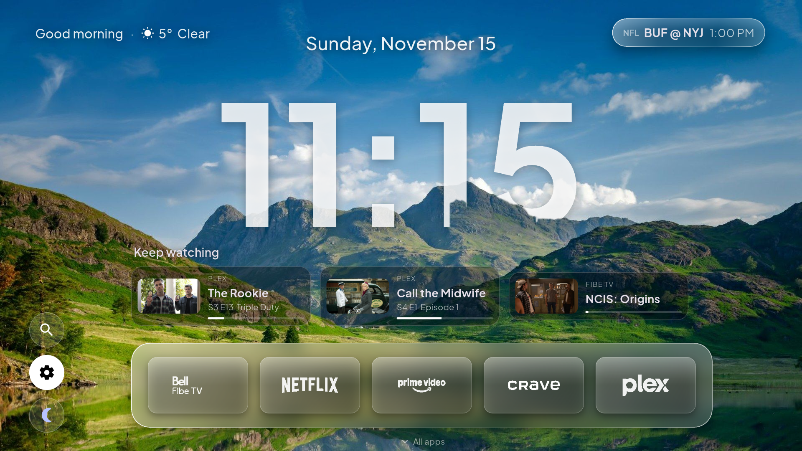
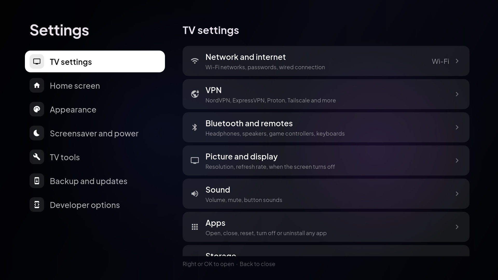
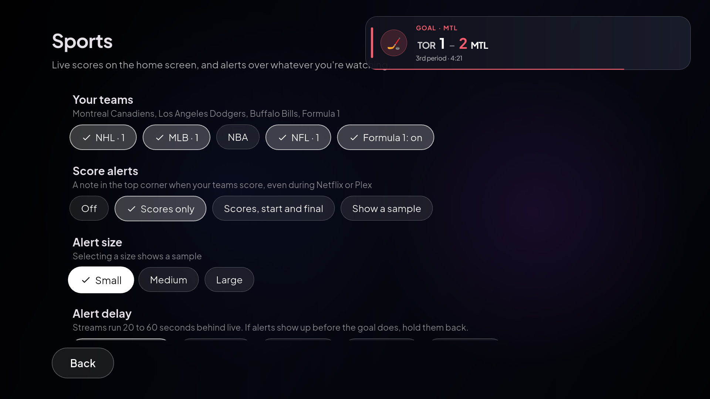
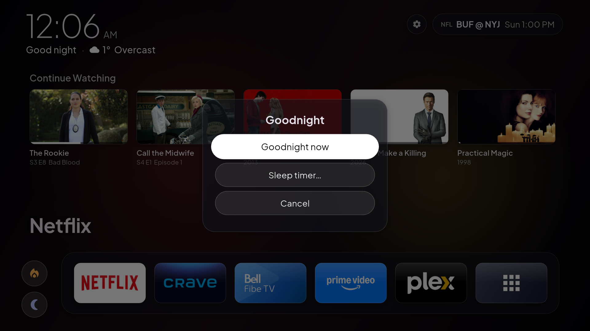
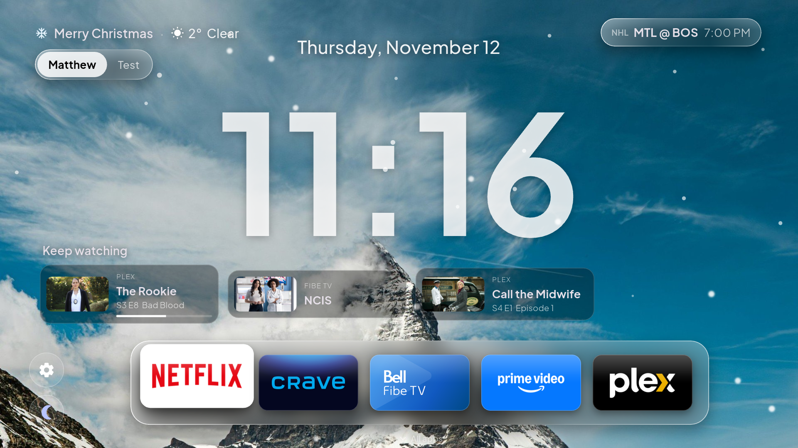
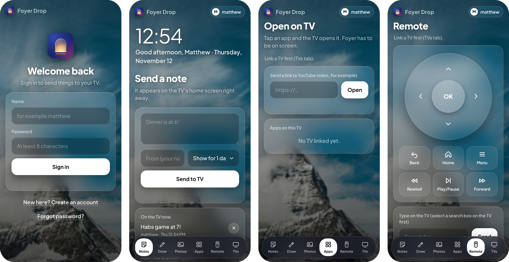

  

<h1 align="center">Foyer</h1>

<b>A calm, ad-free home screen for your TV.</b> 
Your apps, the time, the weather and your team's score. Nothing you didn't ask for.

---

## What is Foyer?

When you turn on most streaming boxes, the first thing you see is a wall of ads, "sponsored" shows and apps you never installed. **Foyer replaces that screen.** Press Home on your remote and you get a clean, good-looking screen with just *your* apps, a big clock, today's weather and a greeting.

Everything you already use keeps working exactly as before: **Netflix, Prime Video, Crave, Disney+, YouTube, Plex, Fibe TV** and anything else from the Play Store. Foyer just changes what you see between them.

  

## What you get

**A home screen that's actually yours**
- Your favourite apps along the bottom, in the order you like
- A big clock with "Good evening · 4° Cloudy" underneath
- Glass-style design that warms up at sunset and dims late at night
- Holiday looks that switch on by themselves: Halloween, Christmas, New Year (with a midnight countdown) and Easter
- Photo backgrounds (a misty meadow, the Matterhorn, a volcano at dusk, a starry lake, a misty forest) with a big clock tucked behind the mountains and trees
- Rain, snow or fog drifting over the background when that's the weather outside
- Press Down on your apps to see all of them, and Up to go back

**No ads, no clutter**
- Google's ad-filled home screen is switched off
- A one-press **Tune-up** turns off Google's tracking and the apps you don't use (and can bring them all back)

**Sports**
- Live scores for your teams (NHL, MLB, NBA, NFL and Formula 1)
- A small pop-up when your team scores, even while you're watching Netflix, in your team's colours

**Little things that make evenings nicer**
- A **sleep timer** that turns the TV off after an episode or two, with a "still watching?" warning
- The **star button** on the remote opens whatever you want (Plex, say)
- Soft click sounds as you move around (or none, if you prefer)
- **Screen off:** the picture goes black while the sound keeps playing, for music or falling asleep to a show
- **Smart idle:** when nobody's watching, a dim drifting clock protects the screen, and a show left paused turns the TV off by itself (after a "still here?" note)

**Your TV's settings, without the maze**
- Wi-Fi, Bluetooth headphones, picture, sound, apps and storage, all inside Foyer
- Settings laid out simply: the sections on the left, their options on the right
- Updates install with one press
- If something ever goes wrong and Foyer keeps crashing, the TV's own home screen steps in by itself for a few minutes, so the TV never gets stuck

**The Foyer companion app on your phone**
- A remote with a real keyboard, plus photos, notes and drawings sent to the TV. [More below](#the-foyer-companion-app).

<table>
  <tr>
    <td></td>
    <td></td>
  </tr>
  <tr>
    <td align="center">All your apps</td>
    <td align="center">Settings, in plain words</td>
  </tr>
  <tr>
    <td></td>
    <td></td>
  </tr>
  <tr>
    <td align="center">Pick your teams</td>
    <td align="center">A goal alert over whatever you're watching</td>
  </tr>
  <tr>
    <td></td>
    <td></td>
  </tr>
  <tr>
    <td align="center">Wi-Fi, Bluetooth, picture and sound</td>
    <td align="center">Goodnight and the sleep timer</td>
  </tr>
  <tr>
    <td></td>
    <td></td>
  </tr>
  <tr>
    <td align="center">A friendly setup the first time</td>
    <td align="center">Holiday themes switch on by themselves</td>
  </tr>
</table>

## The Foyer companion app

Your phone becomes Foyer's best friend. The companion app works on **iPhone and Android**, and there's nothing to download from an app store: you open a link once and add it to your home screen, where it gets its own Foyer icon.

  

- 🎮 **Remote:** arrows, OK, Back, Home and play/pause, from your phone. Handy when the real remote is lost in the couch.
- ⌨️ **Type with your phone:** passwords, searches and Wi-Fi names, typed on your phone's keyboard instead of letter by letter with the remote.
- 📺 **Open on TV:** tap Netflix, Plex or any app on your phone and it opens on the TV.
- 📸 **Photos:** send pictures to the TV, where they show up in the corner of the home screen and in the screensaver.
- 📝 **Notes and drawings:** leave a note ("Pizza's in the fridge") or a doodle, and it pops up on the TV for everyone to see.
- 👨‍👩‍👧 **Everyone in the house:** each person gets their own login for the same TV, and notes show who sent them.

**Getting it:** whoever set up Foyer for you sends you an invite. Open the link, make an account, and on the TV go to **Settings → Home screen → Foyer Drop** and enter the short code it shows. On iPhone, tap **Share → Add to Home Screen**; on Android, **⋮ → Add to Home screen**.

The companion app runs on a small server that belongs to whoever set up Foyer for you (that's what *Foyer Drop* is). Your photos and notes go there, not to some company.

## What TV do I need?

Foyer works on **Google TV and Android TV** boxes and TVs:

| ✅ Works great | ⚠️ Works, with limits | ❌ Doesn't work on its own |
|---|---|---|
| Google TV Streamer, Chromecast with Google TV, Onn 4K Pro, and TVs with Google TV built in (most Sony, TCL, Hisense, Philips) | Amazon Fire TV sticks: Amazon won't let its home screen be fully replaced | Samsung and LG smart TVs. Plug in a Google TV box (like an Onn 4K Pro) and Foyer runs on that |

Got a Samsung or LG? Plug a Google TV box into it and turn on HDMI-CEC (Samsung calls it *Anynet+*, LG calls it *SIMPLINK*). Then the box's remote also turns the TV on and off and controls the volume.

## How do I get it?

Foyer isn't in the Play Store. It's shared with friends and family:

- **Easiest:** ask whoever gave you Foyer to set up your box. They can hand it to you ready to go, and the first time you turn it on, Foyer walks you through the rest with just the remote: Wi-Fi, your name, how it looks and your apps.
- **Doing it yourself:** follow the [step-by-step guide](GUIDE.md). You'll need a computer once, for about 10 minutes.

After that, updates come with one press: **Settings → Updates → Download and install**.

## Common questions

**Will Netflix, Prime and my other apps still work?**
Yes. They're the same apps from the Play Store. Foyer only replaces the home screen.

**Can I go back to the normal Google TV home screen?**
Yes, any time: **Settings → TV tools → Home button → Bring back the TV's own home screen**.

**Does Foyer collect anything about me?**
No. Foyer has no ads and no tracking. Weather and scores come from public sources; Foyer Drop runs on a server that belongs to whoever set it up for you.

**Something looks wrong. What do I do?**
Press **Home** to come back to Foyer. If that doesn't help, try **Settings → Screensaver and power → Restart or sleep → Restart**, then tell whoever set up Foyer for you.

**Is it free?**
Yes.

---

For the person who builds Foyer: build, signing and publishing notes are in [docs/DEVELOPING.md](docs/DEVELOPING.md). Foyer uses the font Plus Jakarta Sans (SIL Open Font License). Smart idle, Screen off, the weather effects, the crash safety net and the settings layout were inspired by [couch-tv](https://github.com/Seagey/couch-tv) (MIT).
