

  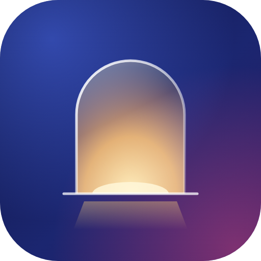

<h1 align="center">Foyer TV</h1>

<b>A calm, ad-free home screen for your TV.</b> 
Your apps, the time, the weather and your team's score. Nothing you didn't ask for.

---

## What is Foyer TV?

When you turn on most streaming boxes, the first thing you see is a wall of ads, "sponsored" shows and apps you never installed. **Foyer TV replaces that screen.** Press Home on your remote and you get a clean, good-looking screen with just *your* apps, a big clock, today's weather and a greeting.

Everything you already use keeps working exactly as before: **Netflix, Prime Video, Crave, Disney+, YouTube, Plex, Fibe TV** and anything else from the Play Store. Foyer just changes what you see between them.

  

## What you get

**A home screen that's actually yours**
- Your favourite apps along the bottom, in the order you like. Press **Down** to see every app, and **Up** at the top to come back
- **Keep watching:** the shows you're part way through, in Plex, Netflix, Disney+, Prime Video, Fibe TV, YouTube and more, with how far in you are. One press picks up right where you left off. Hold OK on one to hide it
- **Now playing:** when Spotify or another music app is playing, the song, artist and cover show first in that row, with play, pause and skip
- **People:** everyone in the house gets their own apps and sports teams. Their names sit under the greeting; pick one to switch, and Foyer says "Good evening, Sarah"
- **Photo backgrounds** with a big clock tucked behind the mountains and trees: a misty meadow, the Matterhorn, a volcano at dusk, a starry lake and a misty forest. They take turns, or **follow the sun**: the real sunrise and sunset where you live decide which one shows
- Rain, snow or fog drifting over the background when that's the weather outside
- "Good evening · 4° Cloudy", and glass that warms up at sunset and dims late at night
- Holiday looks that switch on by themselves: Halloween, Christmas, New Year (with a midnight countdown) and Easter
- **Search everything:** type a show or movie and see which of your apps have it (Netflix, Crave, Disney+, Prime Video…), plus your Plex, apps and games. One press opens it there
- **Little helpers:** press Back twice for your open apps as big cards (Up swipes one away to close it, like on an Apple TV); an orange button when the internet drops, with a fix; a note when the remote or a controller battery is low; Undo after removing an app
- **In English or in French** (Français), picked on the first setup screen or in Settings → Appearance → Language
- **Settings follow you:** a new box (or the PC) can set itself up like any of your other boxes, through Foyer Drop: apps, people, teams, look and weather in one step

**No ads, no clutter**
- Google's ad-filled home screen is switched off
- A one-press **Tune-up** turns off Google's tracking and the apps you don't use (and can bring them all back)

**Games**
- Your own Game Boy Advance, Game Boy, NES, SNES, N64, Sega and GameCube/Wii games, with box art, played in RetroArch or Dolphin
- Send game files from your phone with Foyer Drop (Games tab) and they show up on the TV by themselves
- Pick up the game you played last, right from Keep watching

**Sports**
- Live scores for your teams (NHL, MLB, NBA, NFL and Formula 1)
- A small pop-up when your team scores, even while you're watching Netflix, in your team's colours

**Evenings and bedtime** (the moon button, bottom left)
- A **sleep timer** that turns the TV off after an episode or two, with a "still watching?" warning
- **Screen off:** the picture goes black while the sound keeps playing, for music or falling asleep to a show
- **Soundscapes:** rain, ocean waves, a crackling fire or brown noise, made by the TV itself
- A crackling **fireplace** video
- **Smart idle:** when nobody's watching, a dim drifting clock protects the screen, and a show left paused turns the TV off by itself (after a "still here?" note)

**Your TV's settings, without the maze** (the gear button, bottom left)
- Sections on the left, their options on the right, in plain words
- Wi-Fi, Bluetooth headphones, picture, sound, apps and storage, all inside Foyer
- The **star button** on the remote opens whatever you want (Plex, say), and soft click sounds as you move around (or none)
- Updates install with one press
- If Foyer ever keeps crashing, the TV's own home screen steps in by itself for a few minutes, so the TV never gets stuck

**The Foyer companion app on your phone**
- A remote with a real keyboard, plus photos, notes and drawings sent to the TV. [More below](#the-foyer-companion-app).

<table>
  <tr>
    <td></td>
    <td>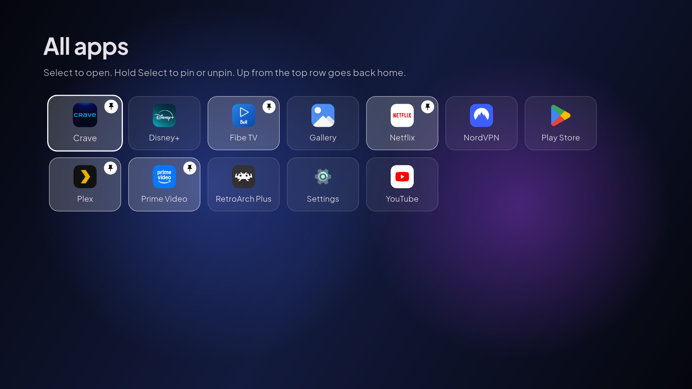</td>
  </tr>
  <tr>
    <td align="center">Settings: sections on the left, options on the right</td>
    <td align="center">Every app, one press down from your row</td>
  </tr>
  <tr>
    <td>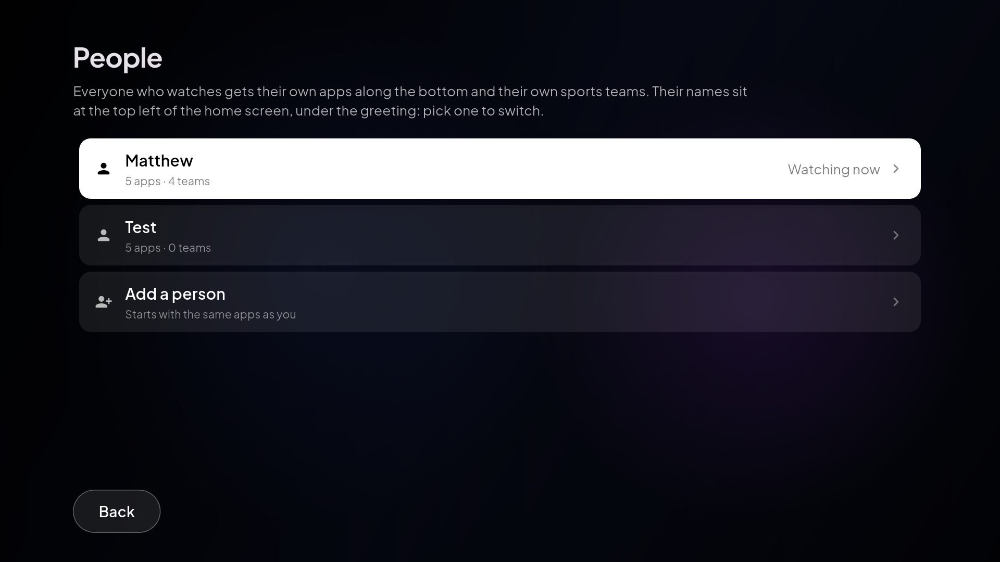</td>
    <td>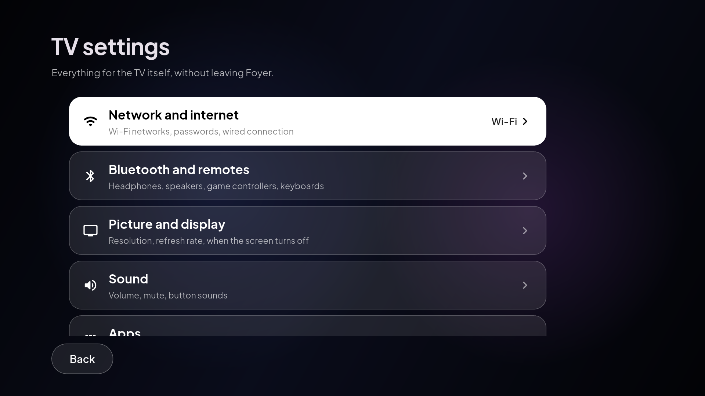</td>
  </tr>
  <tr>
    <td align="center">Everyone gets their own apps and teams</td>
    <td align="center">Wi-Fi, Bluetooth, picture and sound</td>
  </tr>
  <tr>
    <td>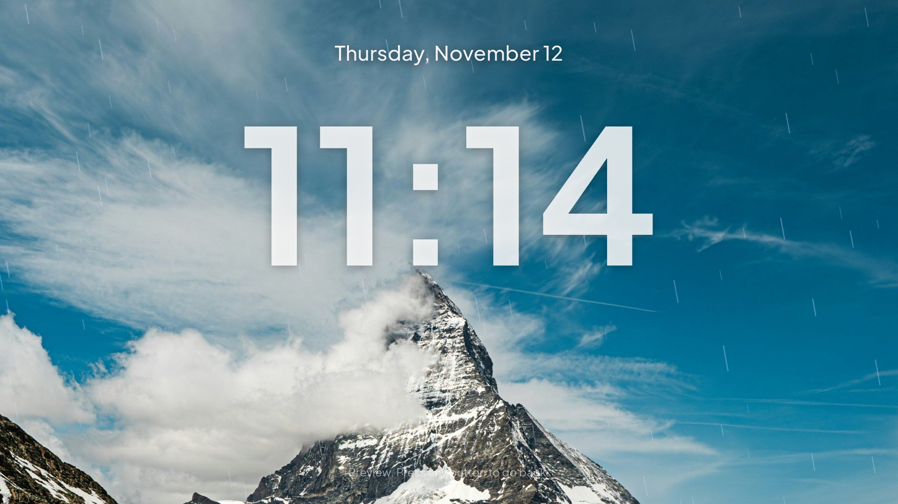</td>
    <td>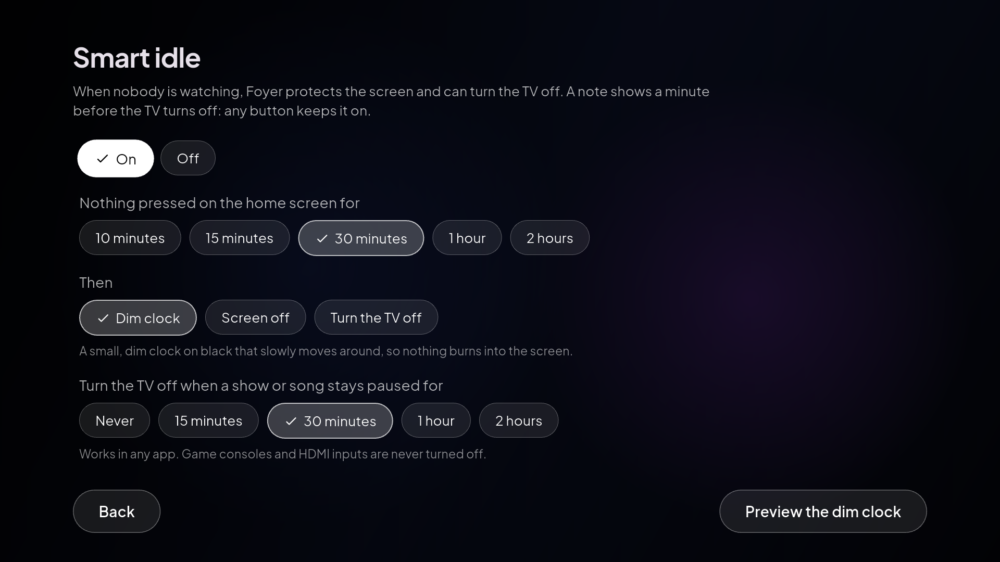</td>
  </tr>
  <tr>
    <td align="center">The weather outside, on the background</td>
    <td align="center">Smart idle looks after the screen</td>
  </tr>
  <tr>
    <td>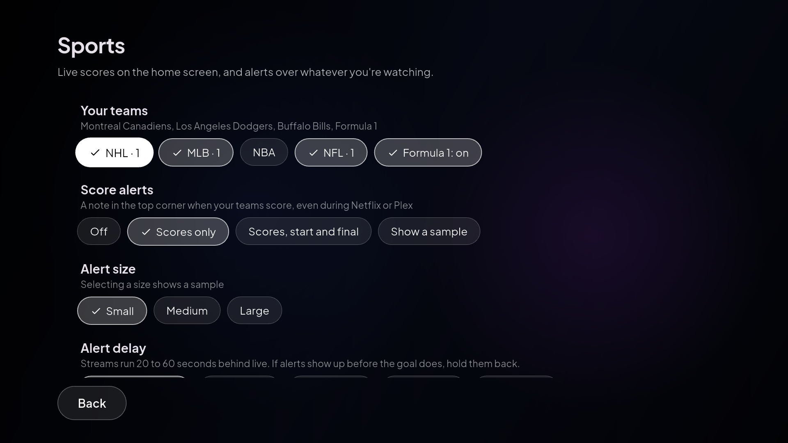</td>
    <td></td>
  </tr>
  <tr>
    <td align="center">Pick your teams</td>
    <td align="center">A goal alert over whatever you're watching</td>
  </tr>
  <tr>
    <td></td>
    <td>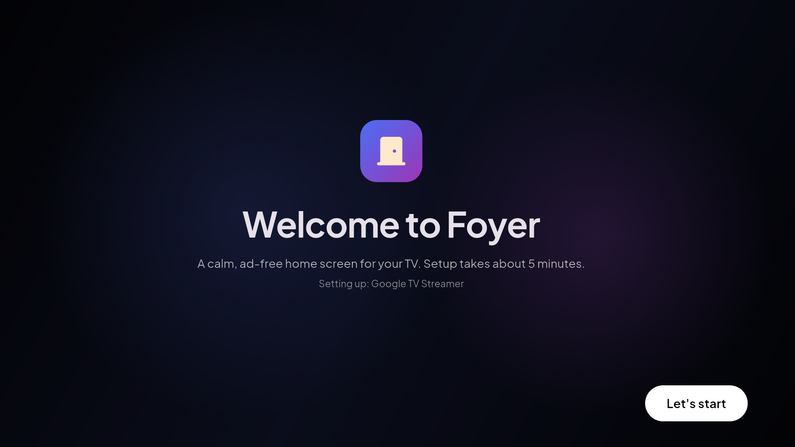</td>
  </tr>
  <tr>
    <td align="center">Goodnight, sleep timer, screen off and the fireplace</td>
    <td align="center">A friendly setup the first time</td>
  </tr>
</table>

**The photo backgrounds.** They take turns, or follow the sun: the meadow at sunrise, the forest in the morning mist, the Matterhorn at midday, the volcano at dusk and the starry lake at night.

<table>
  <tr>
    <td>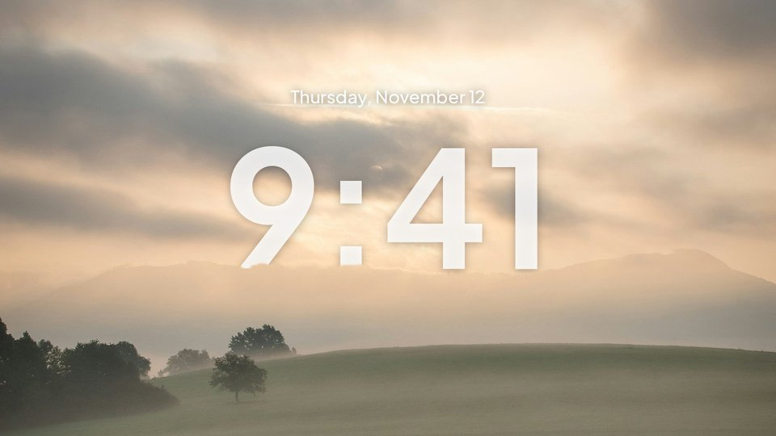</td>
    <td>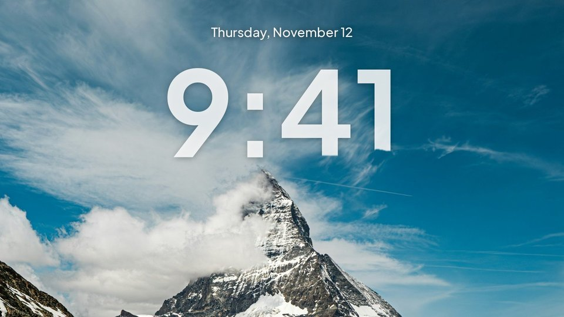</td>
  </tr>
  <tr>
    <td align="center">Misty meadow</td>
    <td align="center">Matterhorn</td>
  </tr>
  <tr>
    <td>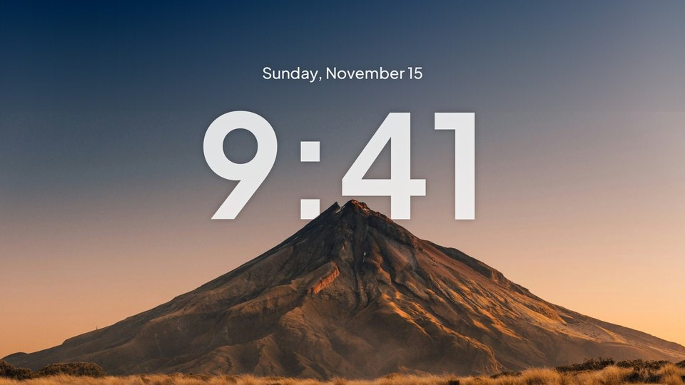</td>
    <td>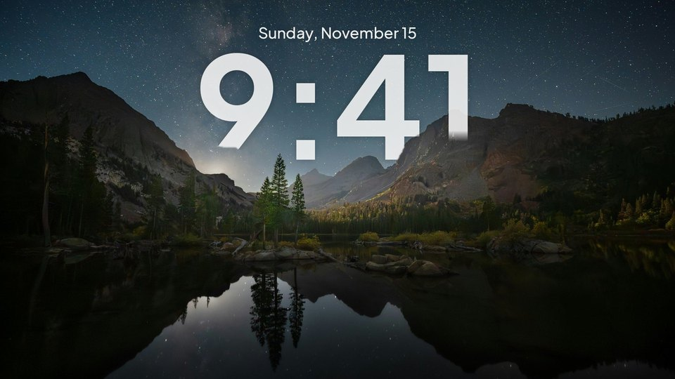</td>
  </tr>
  <tr>
    <td align="center">Volcano at dusk</td>
    <td align="center">Starry lake</td>
  </tr>
  <tr>
    <td>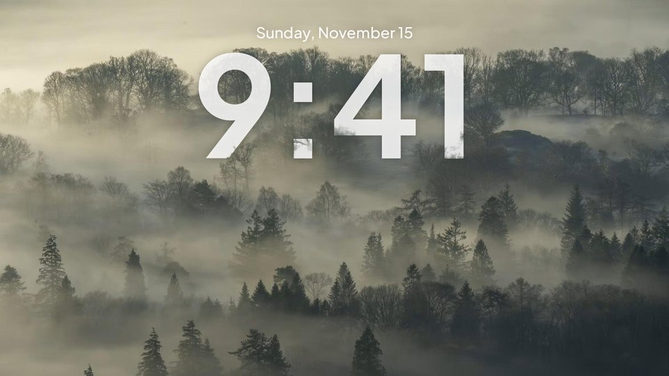</td>
    <td></td>
  </tr>
  <tr>
    <td align="center">Misty forest</td>
    <td align="center">Holiday themes switch on by themselves</td>
  </tr>
</table>

## Where things are in Settings

Press the **gear** at the bottom left of the home screen (or the remote's menu button).

| Section | What's in it |
|---|---|
| **TV settings** | Network and Wi-Fi, VPN, Bluetooth and remotes, picture and resolution, sound, apps, storage, the TV's name, power |
| **Home screen** | Name and clock, your apps, **People**, **Plex**, **Keep watching** (on or off), weather, sports and score alerts, Foyer Drop |
| **Appearance** | **Language (English or Français)**, glass style, wallpaper and **scenes**, performance mode, light that follows the day, **weather on the background**, holiday themes, sounds |
| **Screensaver and power** | Screensaver, **Smart idle**, **Screen off**, start on boot, restart or sleep |
| **TV tools** | Home button, Tune-up, remote buttons |
| **Backup and updates** | Updates, backup and restore, **settings follow you**, reset for someone new, run setup again |

## Foyer for PC

Got a small Windows PC by the TV (a Lenovo ThinkCentre Tiny, an Intel NUC, any mini PC)? **Foyer for PC** is the same home
screen, photo scenes, sports, Plex Keep watching and Foyer Drop, full screen on Windows. Netflix (in 4K), Prime Video,
Disney+, Crave and YouTube open as their own full-screen windows; Plex, Spotify, Kodi and Steam open as themselves.
An air-mouse remote's **Home** button brings you back to Foyer from anywhere, and the phone remote drives the PC too.

Download `Foyer-PC-….zip` from the newest **Foyer for PC** release, unzip it and double-click **Install Foyer.cmd**.

## The Foyer companion app

Your phone becomes Foyer's best friend. The companion app works on **iPhone and Android**, and there's nothing to download from an app store: you open a link once and add it to your home screen, where it gets its own Foyer icon.

  

Sign in · Notes · Open on TV · Remote. It wears the same photo scenes and frosted glass as Foyer on the TV.

- 🎮 **Remote:** arrows, OK, Back, Home and play/pause, from your phone. Handy when the real remote is lost in the couch.
- ⌨️ **Type with your phone:** passwords, searches and Wi-Fi names, typed on your phone's keyboard instead of letter by letter with the remote.
- 📺 **Open on TV:** tap Netflix, Plex or any app on your phone and it opens on the TV.
- 📸 **Photos:** send pictures to the TV, where they show up in the corner of the home screen and in the screensaver.
- 📝 **Notes and drawings:** leave a note ("Pizza's in the fridge") or a doodle, and it pops up on the TV for everyone to see.
- 👨‍👩‍👧 **Everyone in the house:** each person gets their own login for the same TV, and notes show who sent them.

**Getting it:** whoever set up Foyer for you sends you an invite. Open the link, make an account, and on the TV go to **Settings → Home screen → Foyer Drop** and enter the short code it shows. On iPhone, tap **Share → Add to Home Screen**; on Android, **⋮ → Add to Home screen**.

The companion app runs on a small server that belongs to whoever set up Foyer for you (that's what *Foyer Drop* is). Your photos and notes go there, not to some company.

## What TV do I need?

Foyer works on **Google TV and Android TV** boxes and TVs:

| ✅ Works great | ⚠️ Works, with limits | ❌ Doesn't work on its own |
|---|---|---|
| Google TV Streamer, Chromecast with Google TV, Onn 4K Pro, and TVs with Google TV built in (most Sony, TCL, Hisense, Philips) | Amazon Fire TV sticks: Amazon won't let its home screen be fully replaced | Samsung and LG smart TVs. Plug in a Google TV box (like an Onn 4K Pro) and Foyer runs on that |

Got a Samsung or LG? Plug a Google TV box into it and turn on HDMI-CEC (Samsung calls it *Anynet+*, LG calls it *SIMPLINK*). Then the box's remote also turns the TV on and off and controls the volume.

## How do I get it?

Foyer isn't in the Play Store. It's shared with friends and family:

- **Easiest:** ask whoever gave you Foyer to set up your box. They can hand it to you ready to go, and the first time you turn it on, Foyer walks you through the rest with just the remote: Wi-Fi, your name, how it looks and your apps.
- **Doing it yourself:** follow the [step-by-step guide](GUIDE.md). You'll need a computer once, for about 10 minutes.

After that, updates come with one press: **Settings → Backup and updates → Updates → Download and install**.

## Common questions

**Will Netflix, Prime and my other apps still work?**
Yes. They're the same apps from the Play Store. Foyer only replaces the home screen.

**Can I go back to the normal Google TV home screen?**
Yes, any time: **Settings → TV tools → Home button → Bring back the TV's own home screen**.

**Does Foyer collect anything about me?**
No. Foyer has no ads and no tracking. Weather and scores come from public sources; Foyer Drop runs on a server that belongs to whoever set it up for you.

**Is Foyer TV available in French?**
Yes. Pick **Français** on the first setup screen, or go to **Settings → Appearance → Language**. Everything switches at once, and the clock goes to 24 hours.

**I got a second box. Do I have to set it up from scratch?**
No. Link it to Foyer Drop during setup and it asks whether to copy one of your other boxes. You can also do it later in **Settings → Backup and updates → Settings follow you**. Sign-ins like Plex aren't copied, so link those again.

**Something looks wrong. What do I do?**
Press **Home** to come back to Foyer. If it ever keeps crashing, the TV's own home screen takes over for a few minutes by itself. If that doesn't help, try **Settings → Screensaver and power → Restart or sleep → Restart**, then tell whoever set up Foyer for you.

**Is it free?**
Yes.

---

For the person who builds Foyer: build, signing and publishing notes are in [docs/DEVELOPING.md](docs/DEVELOPING.md). Foyer uses the font Plus Jakarta Sans (SIL Open Font License). Smart idle, Screen off, the weather effects, the crash safety net and the settings layout were inspired by [couch-tv](https://github.com/Seagey/couch-tv) (MIT).
